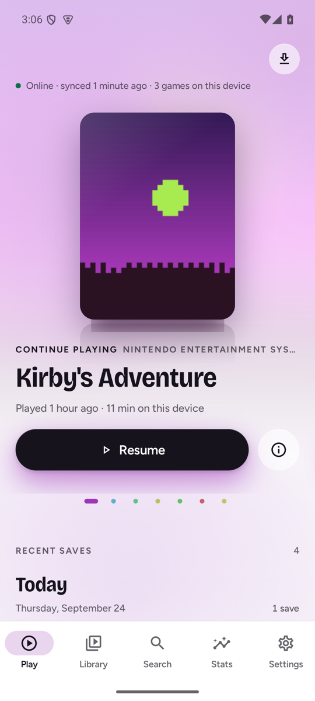
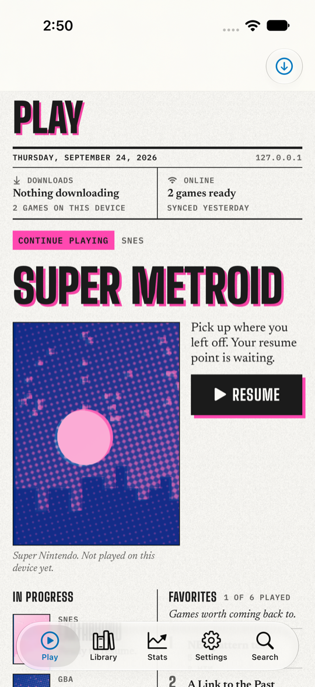
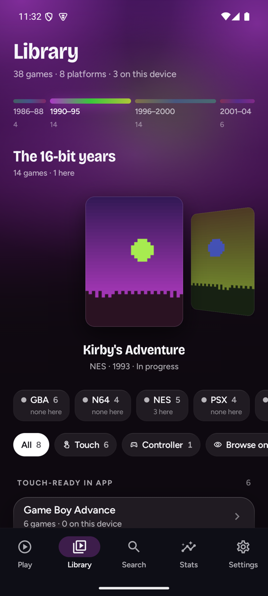
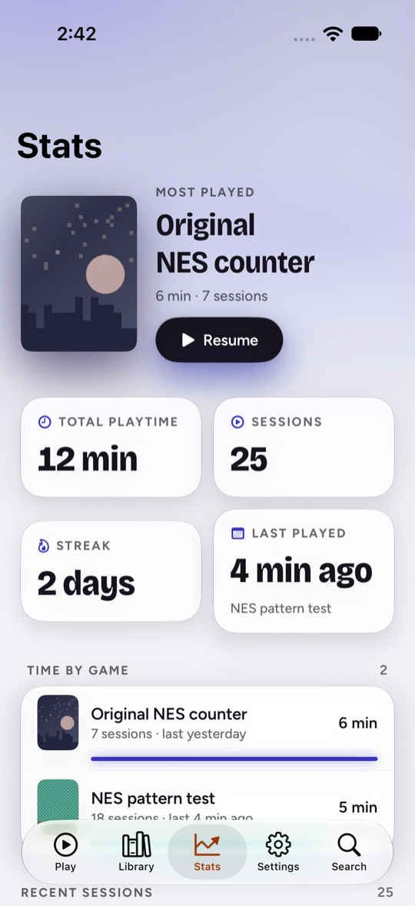
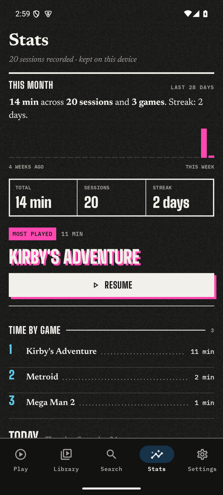
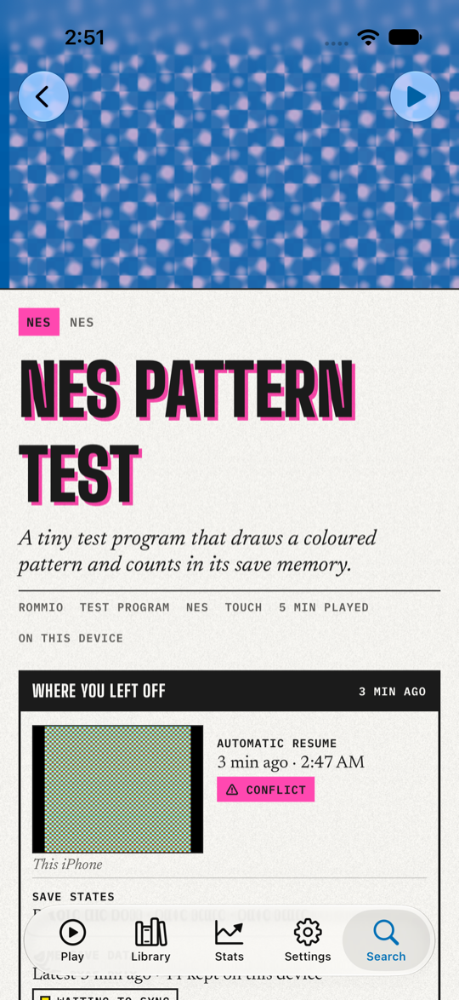

# Rommio

Rommio is a native Android and iOS client for [RomM](https://github.com/rommapp/romm), the self-hosted game library. It browses your library, downloads games for offline play, and runs supported titles in an embedded libretro player with touch controls or a controller. Game saves and resume snapshots sync to your RomM server on the core and server combinations that have been qualified. Android ships as an APK and iOS builds from source. Save sync qualification so far is on simulators and emulators, and physical-device qualification is deferred ([Save sync status](#save-sync-status)).

## Get the APK

Download the latest APK from [GitHub Releases](https://github.com/bandoracer/rommio/releases).

Rommio requires your own RomM server. It does not provide ROMs, BIOS files, or emulator cores.

## Screenshots

Two themes, each in light and dark: **Aurora** (glass over light taken from your games) and **Riso** (two-ink print on paper). Pick one in Settings › Appearance.

<table>
  <tr>
    <td></td>
    <td></td>
    <td></td>
  </tr>
  <tr>
    <td></td>
    <td></td>
    <td></td>
  </tr>
</table>

## Why Rommio

- Native Android and iOS apps with platform navigation: Play, Library, Search, Stats and Settings
- Two designed themes, Aurora and Riso, each in light and dark
- Offline-first browsing once a profile has been hydrated online at least once
- Download queue management with progress, retry, cancel, and local install tracking
- Embedded libretro play for supported platform families
- Touch controls on mobile-friendly platforms and controller-first support for heavier systems
- Local storage for installs, saves, save states, profile cache data, and player preferences

## What You Need

- An Android phone or tablet running Android 8.0+ (`minSdk 26`)
- A working [RomM](https://github.com/rommapp/romm) server
- A first online session so Rommio can cache your library for offline use

Rommio is designed to complement RomM, not replace it. Server administration, library scanning, metadata enrichment, and multi-user management still live in RomM itself.

## Platform Support At A Glance

Rommio uses three support tiers in the app:

- `Touch`: embedded runtime plus first-class touch controls
- `Controller`: embedded runtime exists, but the platform is still controller-first
- `Browse only`: browseable in RomM, but not enabled for embedded playback in Rommio

The current runtime matrix, recommended cores, and validation status live in [docs/core-matrix.md](docs/core-matrix.md).

## Offline And Player Highlights

- Browse Play, Library (platforms and collections), Search, Stats, and game detail from local cache
- See recent saves across games with preview frames, and play time from sessions recorded on this device
- Launch installed titles without a live RomM lookup when the metadata has already been hydrated
- Keep ROM downloads queued while offline and resume automatically when the network returns
- Sync game saves and resume/manual snapshots independently on the qualified route, with verified readback, durable retries and preserved conflicting branches
- Queue core download work for reconnect
- Cache thumbnails for platforms, collections, and games locally so the app still feels complete offline
- Tune the player with touch layout options, OLED black mode, and optional console-inspired control colors; controls follow the chosen theme

## Save sync status

Save sync is qualified per core and per RomM version. Anything not qualified keeps its progress on the device and says so. The first qualified route was NES:

The Android development build synchronizes game saves and resume/manual snapshots independently for qualified, account-bound FCEUmm NROM/Namco games on RomM 5.2.0. Other core/server combinations retain local progress and explicit compatibility limits. Existing saves and pending changes are preserved. See the [progress protocol](docs/progress-protocol-v3.md) and [remediation status](docs/remediation-status.md) for behavior and validation.

Android and iOS now activate independent game-save and resume-snapshot storage/sync for owned, verified single-file NES content using the pinned FCEUmm NROM/Namco layouts and RomM 5.2.0. Actual simulator/emulator exchange and offline iOS process restart are verified. Broader cores and physical lifecycle qualification remain separate gates. See [iOS progress behavior and evidence](docs/ios-progress-player.md) and [iOS build instructions](ios/README.md).

Later passes extend the route to Gambatte, mGBA, Snes9x and melonDS DS ([cartridge progress](docs/cartridge-progress.md)) and to Genesis Plus GX, PCSX ReARMed, Mupen64Plus-Next and PPSSPP ([platform expansion](docs/platform-expansion.md)). Each document lists what it did not qualify. Physical-device qualification is deferred in both, and App Store distribution signing is not qualified ([iOS core matrix](docs/core-matrix-ios.md)).

## How this is built

Rommio is built with coding agents. Of the 45 commits on `main`, 22 carry a Claude co-author trailer, 3 are authored by Codex and 20 carry no label. These practices keep that work honest:

- [AGENTS.md](AGENTS.md) is the agent guide. It requires Android and iOS to be qualified separately and does not accept a shared model or passing unit tests as proof of parity.
- The [validation matrix](docs/validation-matrix.md) lists the checks a platform must pass before it is shown as playable. The [core matrix](docs/core-matrix.md) covers 23 platform families.
- A save counts as synced only after its size and SHA-256 are read back from the server ([progress protocol](docs/progress-protocol-v3.md)).
- A [haptics test](ios/Tests/RommioUITests/HapticsPlaygroundTests.swift) fails any click sound that has a pitch ([why](docs/haptics.md#sounds)).
- Simulator checks, device checks and App Store signing are separate gates ([iOS core matrix](docs/core-matrix-ios.md)). Run reports are kept in [docs/validation/](docs/validation).
- Agent-written Azahar patches are labelled and stay out of upstream, because Azahar's policy prohibits them ([note](docs/ios-3ds-mvd.md#upstream)).

The source holds 470 Swift package test functions, 330 Android unit tests and 255 Android instrumented tests, counted with `grep`.

## Acknowledgements And Licensing

Rommio is licensed under [GPL-3.0-or-later](LICENSE).

This app is built to work with [RomM](https://github.com/rommapp/romm), which is licensed under the GNU Affero General Public License v3.0. Rommio is a separate Android client and is not a ROM source.

Rommio uses [LibretroDroid](https://github.com/Swordfish90/LibretroDroid) for embedded libretro playback. LibretroDroid is licensed under the GNU General Public License v3.0. Rommio bundles FCEUmm from [pinned source](docs/android-pinned-core.md) for offline NES/Famicom core installation and uses the broader libretro ecosystem for other downloadable cores. Each core retains its own license and attribution. BIOS files are supplied by the user and are not bundled.

For direct shipped dependency notices, see [THIRD_PARTY_NOTICES.md](THIRD_PARTY_NOTICES.md).

## For Developers

If you want to build, test, or release the app yourself, start with [docs/development.md](docs/development.md).

Other useful references:

- [Save, sync, and session architecture](docs/save-sync-spec.md) — target behavior shared by Android and iOS
- [Android player ownership](docs/android-application-session.md) — qualified save/resume ownership and current limits
- [Backup bundle format](docs/progress-bundle-format.md) — format-3 save metadata and artifact transfer
- [App remediation plan](docs/remediation-plan.md) — ordered fixes, dependencies, and validation for the structural audit
- [UI studio](design/studio/README.md) — five full-app design directions and a mockup workbench for iterating on every screen
- [docs/core-matrix.md](docs/core-matrix.md)
- [docs/validation-matrix.md](docs/validation-matrix.md)
- [app/](app)
- [scripts/android/](scripts/android/)
