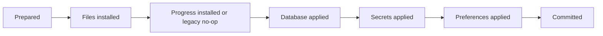

# Android library import recovery

Status: the existing Android migration-bundle path now uses durable forward recovery and an application storage barrier. This is part of R06; account/content namespace migration, iOS migration, actual process-kill/disk-full qualification, and retained-backup recovery UI remain open.

## Activation contract

A bundle is extracted under `noBackupFilesDir/library-imports/<UUID>/`, outside disposable cache storage. Extraction checks duplicate ZIP entries, managed-library paths, reserved metadata, profile/owner consistency, duplicate install/download identities, and referenced installed files. Invalid staging is removed before any active store changes. Inspection also removes its staging directory.

Before activation, the importer persists the new database/control payloads and the previous database/control export. New and previous credentials are retained in the encrypted platform secret store; they are not written into plaintext recovery JSON. Extracted files are flushed and synced, and journal updates use the atomic-file primitive. The user-selected ZIP export still includes its credential payload; this change does not introduce a new portable encrypted archive format.

The importer records these phases:

Each participant is idempotent. If a store commits before its next phase marker is written, recovery repeats that participant. The existing library is renamed to `previous-library` inside the import directory before the staged library takes its place. An import generation marker distinguishes a completed rename from an unrelated directory. Recovery never deletes or replaces an unidentified destination.

After preparation, failures finish forward to the selected bundle. The previous library is retained; the importer no longer rolls files back underneath already-committed database rows. New installs, queue records, controls, pending legacy actions, and sync/recovery journals are applied transactionally where they share SQLite. Pending legacy actions are now included in exported bundles with a backward-compatible optional field. Tombstoned slots are not recreated merely because their old files remain in the archive.

Imported profiles require origin revalidation, even when the archive contains credentials or says a session was connected. Existing verified account guards are retained, incompatible known ownership is rejected during staging, and browser cookie-store identities are rotated. A stored token alone does not establish ownership of imported content.

New exports use [bundle format 3](progress-bundle-format.md), including all v2 metadata and a hashed inventory of progress/recovery files. This replaces the earlier legacy-only transfer refusal. Formats 1 and 2 remain importable: a confirmed replacement retains the prior v2 directory/metadata, then installs an empty v2 snapshot alongside the imported legacy library. The v2 production player writer remains inactive; the legacy player refuses a matching v2 content identity so it cannot silently boot around imported checkpoints.

## Coordinated progress-directory recovery

The production format-3 importer uses a second authoritative root, `progress-v2`, alongside the library. It validates the complete progress inventory and metadata before selecting this journal mode. All new imports stage both roots, including an empty progress root for legacy archives.

When configured, preparation requires both staged roots and writes their generation identities before the pending marker. It records whether each destination previously existed. Recovery retains the old roots as `previous-library` and `previous-progress-v2`, installs both staged roots, then applies database, secrets, and preferences. Any interruption between the two replacements keeps normal application work blocked. A matching generation proves an unacknowledged install; a missing original backup or an unidentified destination prevents further activation. The journal never recreates a backup from the imported replacement.

Directory entries are synced after generation writes, backup/install renames, phase markers, and final marker removal. Preparation syncs staged directory trees from children to parents; the caller still must flush file bytes before preparation. Roots cannot overlap. Symbolic links, including dangling backup links, cannot authorize replacement or redirect traversal. Directory-sync failures propagate and leave the last durable recovery state available for retry.

Three-line legacy pending markers remain readable. They explicitly mean that progress was not part of that import; recovery leaves its root untouched even if a newer caller supplies a progress destination. New four-line markers record the progress participant and refuse recovery without it. Old binaries that do not recognize new phases are not supported rollback targets.

Format 3 preserves exact operations/artifacts, reference heads, outbox intent, history/pins, quarantined data, and interrupted workspace/capture/cleanup journals. Imported leases become pending work; installation identity remains local. Explicit legacy-to-v2 checkpoint conversion, retained-backup recovery UI, production player integration, and process-kill/storage-exhaustion qualification remain open.

## Storage ownership

`StorageAccess` is a coroutine-aware barrier shared by repository operations, authentication, downloads, controls, and native capture/restore calls. An exclusive import/export stops new ordinary operations from starting and waits for existing operations to drain. Nested calls inherit their existing lease. Commands queued behind an import are canceled if activation changed the library generation, preventing stale UI intent from mutating imported data; exports do not advance the library generation. V2 store consumers still reacquire the lazy store after a transfer closes its idle instance. Detached token refresh retains its own lease so canceling its initiating waiter cannot let a late refresh write across activation.

Player engines and interactive browser sign-in hold lifetime leases. Import/export refuses while those sessions are active instead of waiting indefinitely or replacing a running core’s files. A nondismissible transfer dialog prevents normal navigation during the exclusive operation. Download and catalog workers enter through the same guarded queues/repositories. Library path getters are now side-effect-free, so readiness/observer queries cannot recreate the root between activation renames; writers create their directories explicitly.

V2 store operations and the complete application preparation path now also enter this barrier. `ApplicationProgressStorage` lazily owns the store and closes its idle instance only for the exclusive maintenance owner. Import/export invokes closure before taking a stable sibling file lock, and recovery does so before replaying a pending import. The sibling lock remains valid while the progress directory is renamed; competing acquisition cannot recreate that root during the swap. Closing releases the file lock and discards the cached store; the next accepted access opens a fresh instance. An accepted commit drains before closure, waiting old-generation requests cancel after replacement, and an active native session prevents replacement. Merely seeing maintenance in progress does not grant a draining reader authority to close the store.

If an activated import fails, ordinary storage operations remain blocked. `AppContainer` attempts recovery before exposing normal consumers on startup. The app presents a retry-recovery screen on failure. Recovery itself can enter the exclusive barrier while normal work is blocked. These changes establish the import boundary; they do not replace R10’s coherent player session coordinator or the broader R04 browser/authentication qualification.

## Retention and limits

[Migration-bundle format 3](progress-bundle-format.md) includes v2 progress in addition to format 2's account/content scopes and exact manual-state rows. Formats 1 and 2 remain readable. The recovery protocol applies to all new imports.

A successful import retains the prior library, prior database/control export, and encrypted prior credential payload. It removes the pending marker and temporary new credential payload only after all authoritative stores agree. Retention cleanup and an explicit restore-previous-library flow still need implementation; an older backup must not overwrite newer gameplay automatically.

Thumbnail cleanup happens after authoritative activation and cannot cause a file-only rollback. The previous metadata export includes all v2 tables but is not a complete SQLite image: derived caches are rebuilt, and old-format catalog details are not represented as authoritative data.

Recovery staging is no longer OS-evictable cache content. Existing migration directories left by versions predating this journal are not automatically adopted or deleted; their provenance and ownership still require the R06 inventory/mapping flow. Pre-prepare process death may also leave an unactivated staging directory; cleanup must distinguish those from retained committed backups.

## Evidence

The original journal batch below is historical evidence. Current format-3 and storage-lock coverage/results are recorded in [the status document](remediation-status.md) and [the format contract](progress-bundle-format.md).

- Five `ImportRecoveryJournalTest` cases cover interruption after every durable phase, participant commit before phase acknowledgment, both directory-rename boundaries, an initially empty destination, repeated recovery, and rejection of an unexpected destination.
- Six `StorageAccessTest` cases cover draining readers, blocking new work, nested access, a detached refresh outliving its waiter, active-session rejection, canceled maintenance, recovery-required access control, and cancellation of stale commands after replacement.
- Four `MigrationRecoveryTest` cases exercise actual Room, encrypted preferences, DataStore controls, ZIP import/export, database reopen, retained original bytes, revalidation requirements, pending intent, rejection of escaping metadata paths, and side-effect-free path lookup during a directory swap. Faults after file activation, SQLite commit, and secret application converge to consistent new stores after recovery.
- Both Android flavors pass 66 unit tests, lint, and debug builds. The API 35 instrumentation suite reports 39 cases, two existing live-server skips, and zero failures/errors. Log: `/tmp/rommio-import-android-final.log`.

These tests use controlled exceptions and database/owner recreation. They do not establish abrupt OS process death, power-loss durability, disk exhaustion at every phase, minimum-API behavior, or the full UI/browser/device matrix. R06 and F15 remain open until those applicable gates and the broader namespace migration requirements are satisfied.
