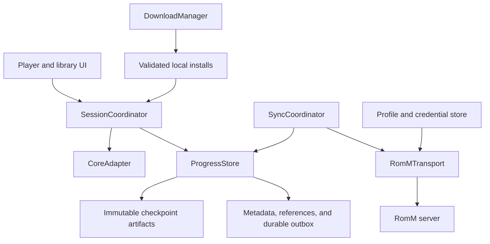

# Save, Sync, and Session Architecture

Implementation note (2026-09-18): the qualified Android and iOS routes implement the two progress streams using [schema 3](progress-protocol-v3.md). This specification remains the behavioral authority; the implementation document records its server/core/platform qualification limits.

Status: **Target architecture; not a description of shipped behavior.**

Last updated: 2026-09-18.

This is the shared behavioral specification for Rommio on Android and iOS. It defines how progress becomes durable, how a player session uses it, and how devices exchange it without silently discarding another branch of progress. Platform implementations may differ; identity, revision semantics, conflict behavior, and acceptance fixtures must agree.

Android and iOS are equally required delivery targets. Synced game saves and synced resume snapshots have equal priority on each platform; Android completion cannot substitute for iOS implementation and qualification. Platform restrictions on background execution must preserve durable retries and truthful status.

This document is authoritative for save and sync behavior where older player or product documentation differs. Runtime availability and platform support remain defined by the [core matrix](core-matrix.md), [iOS core matrix](core-matrix-ios.md), and [validation matrix](validation-matrix.md).

The [app remediation plan](remediation-plan.md) sequences implementation of this specification alongside the other structural audit findings, with dependencies and acceptance gates for each work item.

The [schema-3 wire contract](progress-protocol-v3.md) defines independent game-save and snapshot streams. The [v2 contract](progress-protocol-v2.md) remains the compatibility reference for retained older records. It does not supersede the behavioral requirements below.

## 1. Product contract

1. Installed games remain playable offline. Starting a session must not depend on refreshing the catalog, artwork, or an authentication session when the required local assets exist.
2. A local success message identifies what became durable: **Game-save data saved**, **Save state saved**, or **Automatic resume updated**. Each requires its complete declared artifacts to have committed to local storage. A queued request is not a successful save; persisting game-save data does not invoke the game’s own save action.
3. **Synced** means the committed revision has been published and verified remotely, and reconciliation found no unresolved competing revision in the remote inventory just checked. It is not a promise that an offline device has no unpublished progress.
4. Network failure must not undo a local save. Restarting the app must recover both saved progress and pending synchronization work.
5. Concurrent progress must be preserved. Device clocks, upload order, filenames, and “last modified” timestamps must never decide which gameplay survives.
6. Cloud progress must never replace the memory or writable save files of a running core without an explicit restore operation.
7. Every save belongs to a specific server, account, and game-content identity. Changing the active profile must never retarget existing saves or jobs.
8. Game-save persistence and compatible game-save synchronization must work independently of state capture, storage, transfer, and loading. Unsupported, failed, missing, or incompatible states must not block them. The user must be able to cold boot with compatible game-save data, including when state capture or state synchronization is disabled.

The initial implementation does not promise seamless handoff while two devices are actively playing, universal save-state compatibility, guaranteed background execution, or compatibility with an older client's overwrite-based synchronization. It does promise preservation and an honest explanation when these limits matter.

## 2. Ownership and boundaries

The core is a local player session backed by a durable progress store. Sync operates on committed revisions from that store.



| Component | Owns | Must not do |
| --- | --- | --- |
| `SessionCoordinator` | Session identity, launch selection, lifecycle, capture/restore ordering, exit completion | Delegate critical saves to a screen's lifetime or wait for uploads before committing locally |
| `CoreAdapter` | Core readiness, serialized native calls, persistence capabilities, coherent capture and restore | Choose a cloud winner or own remote credentials |
| `ProgressStore` | Immutable artifacts, checkpoints, logical references, local transactions, recovery and retention | Infer identity from whichever profile is currently selected |
| `SyncCoordinator` | Remote discovery, ancestry comparison, conflict records, publication and reconciliation | Read a changing core working file or replace a live session's chosen progress |
| `DurableOutbox` | Persisted work, leases, retry schedule, per-operation completion | Treat a launched task as completed work |
| `RomMTransport` | Verified server capabilities, authenticated transfer, remote inventory and publication | Implement undocumented overwrite assumptions as conflict resolution |
| `DownloadManager` | Staging, validation, atomic installation, install inventory | Mark partial files or HTTP error bodies as playable content |
| UI | Commands, observed progress, explicit conflict and restore choices | Directly serialize the core, upload save files, or mutate save references |

These are responsibilities, not a requirement for a new package or interface for each row. Existing Android and iOS modules should be adapted around these boundaries.

Core execution, capture, restore, reset, and shutdown must run through one ordered execution lane per session. The coordinator must reject or queue conflicting commands. Swift actor isolation alone is insufficient if an `await` permits another lifecycle command to interleave; coroutine launch order alone is likewise insufficient. Long network operations must not hold the core lane or a database transaction.

Only one writable session for the same progress identity may run on a device. A process-safe ownership mechanism must prevent multiple windows or workers from acquiring it. Remote devices remain independent writers.

## 3. Identity and compatibility

### 3.1 Progress namespace

Every database row, file reference, job, and remote operation must carry these identities explicitly:

| Identity | Definition |
| --- | --- |
| `namespaceId` | Local immutable identifier for a verified server/account binding |
| Server binding | Stable server identifier if available; otherwise an explicitly bound normalized origin and deployment base path |
| Account binding | Immutable server-side user identifier, verified after sign-in; never a display name |
| `contentId` | Immutable local identifier for one installed game-content generation |
| Content binding | RomM ROM ID, selected file ID or ordered file set, and SHA-256 of installed playable content |
| `deviceId` | Installation identifier used for attribution, not authentication or conflict priority |
| `sessionId` | Unique identifier for a single launch and its captures |

Local UUIDs are not cross-device matching keys. Remote records must include the server/account scope and content binding needed to map them to local identities. An account-scoped server location may supply part of that scope only after the transport proves its isolation.

Replaced ROM bytes produce a new content generation even when the RomM numeric ID is unchanged. Multi-disc content must identify the selected set and disc ordering. Archives must record both the downloaded container digest and the identity of the extracted content used by the core. Names, paths, and titles are labels, not identity.

A matching ROM hash alone must not merge progress across accounts or servers. Moving progress between namespaces is an explicit import/copy operation that preserves its provenance. Changing a server URL requires verifying or explicitly remapping the existing server/account binding; editing a URL must not silently redirect pending uploads.

### 3.2 Compatibility descriptors

In-game save data and save states have different compatibility rules:

- **In-game save descriptor:** system, content identity, save format, artifact roles, and any core-specific layout/version required to interpret the files.
- **Save-state descriptor:** all of the above plus core identifier, exact core build/artifact digest, runtime/state-format version, relevant core options, BIOS identity where required, and architecture/platform constraints.

The core build digest identifies the core artifact as built, not a platform's signed or packaged copy of it. Signing is not a core change: an iOS signature records its signing time, so the signed file's digest differs between two app builds of the same core. iOS provenance therefore records `artifactSha256`, the core's digest before the app build embeds and signs it, and snapshots name the core by it; the signed digest (`sha256`) still verifies the file on disk. Android's packaged core is not re-signed, and its digest is already stable.

Exact compatible descriptors are the default for automatic state loading. Cross-build or cross-platform state loading requires an explicitly validated compatibility rule and shared fixture. The one such rule: iOS device snapshots made between 2026-09-23 18:20:27 UTC (the last change to any core build input) and 2026-09-28 00:00 UTC named the signed per-build digest; one that matches the running core in everything else (core, state format, platform, architecture, options, system files) is restored as a snapshot of that core. It applies to `ios` only, never the Simulator (`ios-simulator`, whose cores are other builds) or Android, and a failed restore keeps the snapshot like any other (`ProgressStateCompatibility.restores`). An extension such as `.state` or a shared core name does not establish compatibility. Persist the producing descriptor even after a core update.

If a core cannot expose a stable state-format version, use its exact build identity and conservatively restrict automatic loading. Core updates must leave older checkpoints recoverable. A state incompatibility must offer a cold boot using compatible in-game save data; it must not delete the rejected state.

## 4. Progress model

### 4.1 Four user concepts

| Concept | Behavior |
| --- | --- |
| Game-save data | Persistent data produced by the game: SRAM, RTC where applicable, memory cards, or other core-managed save files. Rommio flushes/copies this data; only the game determines when gameplay is recorded in it |
| Automatic resume | A recent complete emulator state and its matching save-data bundle, suitable for resuming this content/core combination |
| Manual save state | A snapshot of emulator execution, including the state needed to resume at that moment, paired with matching complete game-save data. A slot has a stable UUID and optional name; overwriting creates a new revision |
| Recovery history | Retained prior checkpoints, imports, and conflict branches that can be restored without destroying current progress |

A save state can preserve a moment the player never saved through the game’s own menu. A game save can load through an ordinary cold boot without any emulator state. A checkpoint is a storage container, not a third user-facing kind of save.

Automatic resume is a named reference, not a reserved numeric manual slot. Existing slot zero must be preserved during migration; it must not be silently reclassified or overwritten.

### 4.2 Immutable checkpoints and mutable references

An **artifact** is immutable bytes identified by SHA-256 and byte length. A **checkpoint** is an immutable manifest describing artifacts captured at one coherent point. A **reference** gives a checkpoint a purpose, such as current in-game progress, automatic resume, or manual slot.

Suggested logical reference names are:

- `save/current`
- `resume/<compatibilityId>`
- `slot/<slotId>`

These names are protocol identifiers, not storage filenames. Recovery history retains checkpoints independently of the currently selected references.

An active game-save checkpoint contains a complete game-save bundle and needs no state. An active manual state or automatic resume contains a serialized state paired with a complete game-save bundle from the same capture. Each artifact has a validated logical role and relative path. A save-data bundle is a complete inventory: an absent artifact within a successfully captured bundle means absent in that revision, not “keep an arbitrary file from an older revision.”

When capturing both, state and game-save data must be captured under a single core barrier with no emulation between them. Coherent capture does not make state success a prerequisite for game-save durability. File-backed cores need a verified flush/snapshot mechanism. Do not assume that reading libretro SaveRAM captures memory cards or every persistent file.

If save-data capture succeeds but state serialization fails, commit the save data and report that resume was not updated. The previous resume remains in recovery history but must not automatically rewind newer in-game progress. Track this freshness relationship explicitly. Zero-byte save data is valid only when the core's declared format/capabilities permit it; a failed read must not become an empty successful save.

Rommio’s restore policy is to load a state together with its matching game-save bundle, using the core adapter’s tested ordering. This is a deliberate consistency policy, not a claim that emulator states and game saves are the same thing. Never combine an old state with whichever SRAM file happens to be latest.

If a selected state carries different game-save data from the current revision, explain that loading it also replaces the active game-save data and require confirmation before mutation. Preserve the current game-save revision in recovery history and commit a restorable safety checkpoint; if either preservation step fails, refuse the restore. Cancellation leaves the selected references and running session unchanged. After success, record the intentional rollback as a new revision. Automatic resume must not make this rollback choice on the user’s behalf. Reset also requires a safety checkpoint; it is not permission to delete game-save data.

State-only legacy/imported payloads with no verified matching game-save bundle are preserved recovery items, not active game saves, automatic resumes, or loadable manual slots. Do not mark them complete, attach today’s game-save data, or automatically run them. An explicit recovery attempt uses an isolated session and a qualified adapter to establish a complete matching bundle before promotion to an active checkpoint. If that cannot be established, retain the original as unavailable for safe restoration. A qualified core with genuinely no persistent game-save data can declare a complete empty bundle; missing data is not an empty bundle.

### 4.3 Revision and operation records

The shared logical schema is version 2. Its serialized encoding, endpoint mapping, and publication mechanism must be frozen after the transport capability investigation in section 8, before either client ships it.

| Record | Required information |
| --- | --- |
| Artifact | SHA-256, byte length, media/format identifier, role, safe relative path |
| Checkpoint | Schema version, checkpoint UUID, content binding, compatibility descriptors, artifact inventory, device/session IDs, capture reason, informational capture time |
| Reference change | Reference name, parent operation IDs for that reference, target checkpoint UUID or explicit tombstone |
| Operation | Schema version, operation UUID, namespace/content binding, one or more reference changes, referenced checkpoint manifests, device/session IDs, informational creation time |
| Local reference state | Selected head, all known competing heads, remote inventory watermark if available, last verified publication |
| Outbox entry | Operation UUID, immutable payload digest, namespace/content IDs, dependency IDs, status, attempts, lease, next attempt, last error |

Game-save publication must have an independently complete commit unit whose artifact and ancestry dependencies do not require state bytes or successful state publication. Otherwise a failed or large state upload would block ordinary game-save synchronization. State/resume publication may depend on its matching game-save revision; the reverse dependency is forbidden. A coherent local capture may commit the corresponding records transactionally without making their remote publication inseparable.

Any operation that changes multiple references remains atomic: receivers validate its complete dependencies before applying it. Independence must be established by the protocol’s commit units, not by partially applying an envelope, stripping artifacts, rewriting immutable operations, or inventing ancestry. The current schema-2 same-operation resume rule needs reconciliation with this requirement before cloud activation; freeze and test the necessary format/migration decision first. Existing coupled operations remain preserved until that migration is defined.

Each reference has its own causal history. A normal change names the selected previous operation for that reference as its parent. A conflict resolution names all resolved competing heads. Initial creation has no parent. Parent lists must not claim to have incorporated progress that the session never loaded or the user never resolved.

Operation IDs are generated once and reused for retries. The same ID with different contents is a protocol error. Timestamps are diagnostic only. Unknown schema versions must be preserved and surfaced as requiring an update; they must not be applied, overwritten, or garbage-collected by an older client.

Validate schema limits, namespace/content bindings, artifact paths, and acyclic ancestry before accepting an operation. A missing parent leaves an operation pending discovery; it must not be interpreted as a new root. A parent from another namespace/content identity is invalid.

## 5. Local durability and recovery

Store metadata, references, conflicts, and the outbox in a transactional local database. Store artifact bytes in app-private storage outside purgeable caches. A possible layout is:

```text
progress/
  <namespaceId>/
    <contentId>/
      blobs/<sha256>
      staging/<captureId>/...
      working/<sessionId>/...
```

The core writes only to its session working directory. Immutable blobs must never be handed to the core as writable files. Server titles, remote filenames, credentials, and unvalidated relative paths must not become filesystem paths.

### 5.1 Commit protocol

1. Acquire the session capture barrier and snapshot the declared persistence artifacts into a unique staging location.
2. Release the barrier once the snapshot bytes are independent of the core. Validate completeness, compute hashes, and flush the staged files.
3. Install artifacts under immutable blob names using atomic same-volume rename. If a blob already exists, verify its expected length/hash before reuse. Apply file and directory durability primitives supported by the platform.
4. In one database transaction, insert the complete checkpoint and operation records, update their local references, retain necessary history, and enqueue publication work. Enqueue even when currently offline; a profile without automatic sync records the revision as local-only.
5. Commit the transaction before acknowledging the specific game-save, manual-state, or automatic-resume result. Network publication happens afterward. A game-save success must not acknowledge a failed manual state request.

Filesystem and database writes are not one atomic transaction. The ordering above permits orphan blobs but forbids a successful database commit that intentionally references not-yet-installed bytes. Do not keep a database transaction open while calling the core or uploading.

If state storage fails but the complete game-save bundle can still be committed, commit that bundle and report game-save success separately from state failure. If there is insufficient space even for that bundle, retain the last committed game-save checkpoint and report game-save failure. Do not evict pending uploads, manual slots, or conflict branches to make a new save appear successful.

### 5.2 Startup recovery

On startup, before enabling playback for affected content:

- Recover database transactions and expired outbox leases.
- Ignore incomplete staging captures; clean them only after confirming no live owner exists.
- Validate the artifacts required by the requested action before use. Damaged state bytes disable that state/resume but must not disable independently verified, complete game-save data from the same capture. Preserve damaged originals and offer compatible game-save cold boot or a verified recovery checkpoint.
- Discover unreferenced installed blobs for later garbage collection; do not adopt them as current progress merely because they look newer.
- Preserve pending operations and their artifacts until publication or explicit user discard.

Retention defaults are the latest 10 unpinned automatic checkpoints per content identity, in addition to all referenced, manual, unsynced, conflicting, and explicitly pinned checkpoints. Garbage collection operates on reachability and grace periods, not file age alone. No remote blob or operation garbage collection is enabled in the initial protocol; safe pruning requires a separate design for offline devices and tombstones.

Here, retained references mean current heads and explicit recovery pins, not every historical operation edge. Keep causal operation metadata when pruning eligible historical artifact bytes. Mark intentionally evicted history as remote-only or unavailable, so recovery does not mistake planned eviction for corruption. Remote history will grow in the initial release; expose its usage and storage failures rather than promising bounded remote retention.

## 6. Session lifecycle

### 6.1 Launch

The coordinator follows this ordering:

```text
Preparing -> SelectingProgress -> LoadingCore -> Restoring -> Running
                                                       <-> Paused
Running/Paused -> Checkpointing -> Running/Paused/Closing -> Closed
```

Failures retain the last committed progress and expose a recoverable error state. `LoadingCore` must not be represented as a playable session.

1. Freeze namespace, content generation, core compatibility, and session ID.
2. Validate the local install, core, required BIOS, and local progress inventory.
3. If online, attempt a bounded remote reconciliation before choosing progress. The initial automatic wait budget is three seconds; further waiting is a user choice. Known conflicts require a choice of branch, a preserved copy, or cancellation.
4. If offline or the remote check cannot finish, allow explicit continuation from local progress with **Cloud progress not checked**. A device with no local progress may start fresh with the same disclosure. A later remote response becomes a candidate/conflict; it must not replace the chosen session.
5. Freeze the selected revision and causal base for this session. Materialize its save-data bundle into the working directory before the core consumes persistent data.
6. Load the core and await an explicit ready signal. Apply a compatible resume state only after readiness and using its matching bundle. If restore fails, preserve the checkpoint and offer a cold boot with compatible save data.
7. Enter `Running` and enable input only after preparation and restore complete.

When a session continues offline from an older baseline, its later captures remain descendants of that baseline. Observing a cloud head in the background does not make local gameplay a descendant of it. Incoming remote revisions may be downloaded while playing, but must remain separate candidates until a safe session boundary or explicit restore.

### 6.2 Capture policy

Initial defaults, subject to measured performance on supported cores:

| Trigger | Required behavior |
| --- | --- |
| Save state | Capture state and matching complete game-save data immediately; update the named slot only after the full state checkpoint commits. On state failure, preserve the old slot and separately report any successful game-save capture |
| Persist game-save data | Flush/capture the game’s existing persistent data without requesting a state or updating a manual slot; this does not trigger the game’s own save action |
| Foreground play | Attempt save-data capture every 30 seconds and automatic resume every 120 seconds |
| Pause/menu | Capture changed save data and automatic resume when supported |
| Background transition | Prioritize local capture within available execution time; persist outbox work before requesting remote work |
| Exit | Commit final progress before releasing the core; upload may continue independently |
| Load older checkpoint/reset | Commit a safety checkpoint first, then perform the explicit action |

The core adapter must identify supported capture points and serialize all capture operations with emulation. Coalesce overlapping periodic requests, but do not silently drop a manual save or an exit request. Avoid new revisions for an unchanged complete payload unless an explicit restore/resolution changes causality.

The intervals are capture targets, not a guarantee against progress loss during abrupt OS termination or native crashes. Background callbacks are an additional opportunity, not the primary durability strategy. UI text must expose the last successful local save if a capture fails.

If final game-save capture fails, keep the session paused and offer retry or explicit exit without the latest game-save data. If only automatic-resume capture fails, report the successful game-save commit and unavailable latest resume separately; permit exit using the durable game-save data. Do not describe that as discarding the successfully saved game-save data. A screen disappearing must not cancel a committed save or its outbox entry. On restore failure, return to a verified prior working state or stop cleanly; never continue with an unknown mixture of memory and files.

## 7. Reconciliation and conflicts

### 7.1 Compare ancestry, not clocks

Reconciliation uses operation ancestry for each reference, plus artifact hashes for content equality. It must obtain a complete remote inventory through pagination or a proven incremental cursor before inferring absence or declaring the checked inventory reconciled.

| Local and remote relationship | Action |
| --- | --- |
| Same operation/head | No transfer needed after required artifacts are verified |
| Remote is an ancestor of local | Publish missing local descendants |
| Local is an ancestor of remote, with no active session using the old base | Download, validate, and fast-forward local references atomically |
| Local is an ancestor of remote during an active session | Stage remote as a candidate; do not change the session's selected progress |
| Divergent descendants | Preserve both and create a conflict |
| Independent imports with no common ancestor | Preserve both; differing progress requires an explicit choice |
| Remote listing omits a local reference | Do not infer deletion; retain local progress |
| Explicit tombstone competes with an edit | Treat as a conflict unless ancestry establishes an intentional later deletion |

Identical complete payloads with matching compatibility descriptors may be reconciled automatically through a merge operation referencing both heads. Compare game-save references using their complete game-save inventories and save compatibility, independently of state bytes and state compatibility. State/resume references compare the state and its matching game-save bundle. Different state snapshots with identical game-save data must not, by themselves, create a game-save conflict. Equality must compare the relevant full artifact inventories, including absence and slot metadata where applicable. A filename or synthetic hash such as `remote:<name>:<time>` is never a content hash.

Per-device serialization prevents local races; it does not prevent two devices from producing concurrent operations. A presence indicator or session lease may warn that another device is playing, but must not authorize discarding progress or block offline use.

### 7.2 Conflict experience

A conflict record retains every competing checkpoint and shows device, capture reason, informational time, compatibility, and a preview when available. The user can choose which progress to continue, preserve the other as a named recovery/manual copy, or cancel. Preserving both is the default; resolution changes the selected head without immediately deleting the unselected checkpoint.

The resolution operation references all heads it resolves. Selecting older progress is an intentional new revision, not a clock adjustment. Incompatible states may be retained even when only one branch can be played on the current device.

Conflicts affecting current in-game progress or the selected resume must be resolved before automatically loading that branch. A conflict in an unrelated manual slot need not block gameplay, but it must remain visible and prevent an account-wide **Everything synced** claim.

### 7.3 Deletion

Deleting a synchronized slot creates a versioned tombstone with the current head as its parent. Refreshing a remote listing must not clear a tombstone or resurrect a slot. Deletion racing with an unseen edit preserves the edit as a conflict.

Removing a downloaded ROM, evicting a local artifact cache, deleting a manual slot everywhere, and clearing all progress are distinct actions. ROM removal must preserve progress by default. Local removal must not emit cloud tombstones unless the user explicitly requests deletion of synchronized progress. Tombstones remain available to reconnecting devices; retention pruning must not make an old device resurrect deleted data.

## 8. RomM transport: required investigation and decision gate

The current clients' use of save/state list and upload endpoints does **not** establish safe compare-and-swap, append-only publication, or server-side conflict resolution. This specification makes no claim that a currently deployed RomM version supplies those features.

Before implementing remote publication, produce an executable capability probe against the intended server version and a checked-in result describing:

| Capability | Evidence required |
| --- | --- |
| Account isolation | Two accounts cannot list/read/write each other's private progress unless intentionally authorized |
| Object identity and overwrite | Uploading distinct names and retrying the same name/ID have known behavior; normalization cannot collapse distinct operation IDs |
| Manifest storage | A supported location accepts versioned operation manifests and returns their original contents |
| Inventory | Pagination, completeness, visibility delay, and stable identifiers are understood |
| Conditional mutation | If used, an actual version/ETag precondition rejects a stale writer atomically |
| Transfer verification | Byte length/hash can be verified by metadata or readback; HTTP errors cannot be mistaken for artifacts |
| Retry ambiguity | A dropped response after successful upload can be discovered without creating a conflicting new logical operation |
| Authentication and URLs | Credential scope, redirect behavior, and download origins are verified |

Choose one proven transport mode:

**A. Conditional heads.** Upload immutable artifacts and operation manifests, then publish a head or head-set using an atomic version precondition. A failed precondition triggers discovery and reconciliation. If an operation changes multiple references, the conditional publication must cover the complete reference set or one root manifest; independent uncoordinated head writes do not provide atomic publication.

**B. Immutable operation inventory.** Upload uniquely identified artifacts, then publish each immutable operation envelope as the commit marker. Discover all operations and derive the set of causal heads. Concurrent operations remain multiple heads until resolution. The transport must provide eventual discovery without silently losing records; a mutable “latest.json” is insufficient. Duplicate physical uploads are acceptable only if receivers deduplicate an identical operation ID and payload and all records remain discoverable.

Both modes must publish artifacts before their referencing commit marker. A receiver that sees a marker before all artifacts are visible leaves it pending and retries; it does not load partial progress or treat visibility delay as corruption immediately. Publication is acknowledged only after the transport verifies the committed operation and required bytes. A final discovery pass determines whether competing heads are already visible.

If neither mode can be proven with the available server APIs, ship durable local saves and explicit import/export while the transport is redesigned or server support is added. Automatic destructive overwrite is not an acceptable fallback. This gate is required for correctness, not an invitation to assume new RomM endpoints exist.

### Legacy and external writers

Older Rommio clients and other emulators may overwrite fixed save filenames without preserving ancestry. Their files are external imports, not protocol-v2 heads. Import each changed payload as a preserved revision, using the actual downloaded hash. Never assign it ancestry based only on its modification time.

The initial protocol must not automatically mirror its selected winner into a shared legacy filename that other clients can overwrite. Explicit legacy export may be offered as a separate action. Full non-destructive synchronization cannot be claimed for unmanaged writers that do not participate in the revision protocol; the UI and compatibility documentation must say which client/server combinations are supported.

## 9. Durable work and networking

Every locally committed sync-eligible operation has a durable publication job created in the same transaction. The queue is scoped by immutable namespace/content identity and survives navigation, process death, sign-out, and temporary unavailability.

The job lifecycle is `pending -> leased -> completed`, with persisted `retry`, `authBlocked`, and `unsupported` outcomes. Expired leases return to pending. A conflict is a persisted domain condition; successfully publishing a preserved branch does not make its conflict resolved.

- Process artifact dependencies before publishing the operation that references them.
- Publish ancestor operations before their descendants; a receiver retries discovery of missing dependencies rather than inventing ancestry.
- Use the same operation ID and immutable payload on every retry. Read back after an ambiguous response before deciding whether publication is missing.
- Retry transient errors with exponential backoff and jitter; honor server retry guidance. Authentication failures park work for that account. Invalid payloads and unsupported protocol versions become actionable errors.
- Acknowledgment must refer to the uploaded revision. If a newer local capture appears during upload, it remains pending; completing an old job must not clear a generic dirty flag for the whole game.
- Do not coalesce away manual saves, tombstones, resolutions, or parents needed to interpret later operations. Initial implementation should retain all unpublished operations rather than optimize them away.
- Game-save work is prioritized independently of state uploads and catalog/artwork hydration. A large, failed, or unsupported state transfer must not prevent ready game-save work for this game or later game-save revisions from publishing. State incompatibility on a receiving device does not disqualify compatible game-save data. This requires independent dependency chains, not just queue priority.
- Reactivate eligible jobs at startup, foreground, reconnect, and supported OS background opportunities. Persist before scheduling. Android workers and iOS background tasks are execution mechanisms, not the queue itself.
- No fixed background delivery deadline is promised. Show pending work until verified completion.

Network requests resolve credentials from the job's bound account, never the active screen's account. Refresh failures caused by connectivity or server errors must not erase credentials or local progress. Confirmed invalid credentials pause remote work until sign-in succeeds.

Only trusted configured origins may receive credentials. Validate redirects and any server-supplied download URL; do not forward authorization to an arbitrary artwork, save, or ROM host. A cross-origin signed download may be fetched without app credentials when the adapter explicitly supports it.

## 10. Installs, accounts, and storage operations

### Validated installs

Download ROMs into a unique staging file. Check HTTP status, expected length/hash where supplied, and required container/content validity before atomic installation. Compute the installed content digest even when the server provides none. A canceled transfer or an HTML error response must never become an installed game. Startup recovery must distinguish partial downloads from validated installs.

Replacing an install creates or selects the appropriate content generation. It must not rebind old checkpoints to new bytes based on title or ROM ID alone. Removing a game must not remove its progress or cancel already committed save publication.

### Profile lifecycle

- Switching profiles affects future UI selection and launches only. Existing sessions and jobs keep their original binding.
- Signing out removes or invalidates that account's credentials and parks its work. It does not delete progress.
- Removing a server/profile preserves a recoverable local progress archive by default and prevents further remote work until an explicit verified reattachment.
- Any “delete local data” action must explain whether unpublished progress will be lost and require an explicit discard for that progress. It must not imply cloud deletion.
- Changing accounts on the same server creates a different namespace. Cached metadata, file paths, outbox entries, and conflict records must remain isolated.

## 11. Observable user state

Local durability and remote synchronization are separate state dimensions, reported separately for game-save data, automatic resume, and manual states. UI actions use **Save state**, **Load state**, **Resume**, or **Start with game save** as appropriate. Any app action that merely flushes game-save data must say so; **Save game** is reserved for the game’s own action. A bare **Saved** or **Save failed** must not conflate these outcomes:

| Local state | Meaning |
| --- | --- |
| Saving game-save data / Saving state | The named capture/commit is in progress |
| Game-save data saved · time | The complete game-save bundle is durable; no assertion about state capture or the game’s internal save menu |
| Save state saved / Automatic resume updated · time | The state and its matching complete game-save bundle are durable |
| Game-save data saved; state failed | Game-save durability succeeded, but the requested state/slot/resume was not updated |
| Game-save capture failed · last saved time | The last committed game-save revision remains available; latest persistent data is not yet confirmed durable |

| Remote state | Meaning |
| --- | --- |
| Local only | Automatic sync is disabled or unsupported for this profile |
| Waiting to sync | Durable operations remain pending, including offline work |
| Syncing | A persisted job is actively transferring or reconciling |
| Synced · last checked time | Current relevant references were verified against the checked inventory |
| Sign-in needed | This account's remote work is parked |
| Game-save sync failed · game-save data safe locally / State sync failed · state safe locally | A remote error affects the named data type; its local durability is independently confirmed |
| Conflict | Multiple progress branches require a choice |
| Cloud progress not checked | Session selection proceeded without a completed remote check |

For example, show **Game-save data synced; resume waiting to sync** when only the game-save revision has completed publication. Never display **local game-save data safe** when game-save capture itself failed. Do not display a general **Synced** badge while manual slots or deletions are still pending. “Sync now” drains and reconciles all eligible progress for the selected scope; it must not be a special path required to upload manual slots.

Diagnostics must expose namespace/content IDs, session/checkpoint/operation IDs, capture result and latency, queue depth/oldest age, transport mode, compatibility rejection, and last remote error. Logs must omit tokens, signed URLs, and raw save contents. A support export should allow reconstructing causality without including game data by default.

## 12. Migration from existing storage

Migration must be resumable, versioned, and tested with fixtures from both clients. Do not enable the new writer alongside the old mutable-file writer for the same progress.

1. Inventory existing SaveRAM, state files, manual slots, resume aliases, metadata, and queued work. Preserve originals before changing references.
2. Bind each item to a server/account/content identity only where existing evidence supports the mapping. Ambiguous global paths go to a recovery/import inventory; do not assign them to the currently active profile.
3. Hash and preserve each distinct payload. Complete verified bundles can become immutable checkpoints; state-only or compatibility-unknown payloads remain recovery inventory until they satisfy section 4.2. Preserve differing manual-slot and hidden-resume files, including slot zero. Deduplicate identical bytes without discarding distinct user-visible slot identities.
4. Mark unknown core/content compatibility explicitly. Do not automatically load a legacy state whose compatibility cannot be established. Offer compatible save-data import or an explicit recovery attempt that first preserves current progress.
5. Convert durable jobs where their destination and payload can be verified. Reconstruct missing work from known local revisions; do not replay ambiguous jobs under new credentials.
6. Commit the new inventory and migration marker atomically in the database. Re-running migration must not create duplicate logical revisions or uploads.
7. Retain the original backup until validation succeeds and the user can recover it. Rollback must restore a consistent database/filesystem pair; restoring files alone after database changes is insufficient.

Remote legacy files must be discovered and preserved before a migrated client proposes a winning reference. Migration itself must not issue destructive remote updates. Reconciliation with an unrelated legacy payload follows the conflict rules above.

## 13. Acceptance scenarios

Each scenario is a shared behavioral fixture or integration test, with Android/iOS-specific harnesses where needed. “Pass” requires checking committed artifacts and references, not only a success callback or toast.

| ID | Scenario | Required result |
| --- | --- | --- |
| S01 | Save in-game, terminate process, relaunch offline | Latest completed in-game checkpoint is restored |
| S02 | Produce two different automatic resumes, relaunch after the second | The second checkpoint loads; no stale hidden resume alias |
| S03 | Remote preparation is delayed past launch budget | Local branch starts only through the defined selection path; late data never replaces a running core |
| S04 | Core readiness is delayed | State load happens after the ready event and before gameplay/input |
| S05 | Terminate during each file/DB commit boundary | Previous or new complete checkpoint is recoverable; never a half-committed current checkpoint |
| S06 | Capture/commit fails because disk is full | Last valid checkpoint remains; UI reports local failure; exit does not falsely acknowledge save |
| S07 | Exit/navigate immediately after capture | Local commit and outbox survive destruction of the screen |
| S08 | Restart with a leased/running job | Expired work resumes and publishes the original operation ID |
| S09 | Server accepts upload but response is lost | Retry/readback produces one logical operation and correct completion |
| S10 | New save occurs during an older upload | Newer revision remains pending after the older acknowledgment |
| S11 | Two devices play offline from a common checkpoint | Both branches survive reconnect and require resolution |
| S12 | Device clocks differ or move backward | Winner/conflict result is unchanged |
| S13 | Devices independently produce identical full payloads | Safe causal merge succeeds without spurious data loss |
| S14 | Delete a slot, then refresh/reconnect an old device | Tombstone persists; a competing new edit becomes a conflict |
| S15 | Manual slot saved without pressing Sync now | It is queued and published automatically |
| S16 | Switch profile while upload is queued or active | Work remains bound to the original account and content |
| S17 | Same ROM ID/title appears on another server/account or with changed bytes | Progress remains isolated by namespace/content generation |
| S18 | Core serializes no states but supports in-game saves | In-game persistence and sync still work; resume capability is honestly unavailable |
| S19 | Core uses memory-card/file-backed persistence | Complete files survive capture, restore, process death, and transfer |
| S20 | Restore older state after newer game-save data was saved | Explain the paired game-save rollback and require confirmation. Preserve the newer game-save revision and a safety checkpoint before mutation. Cancellation changes nothing; confirmed restore becomes a new revision |
| S21 | State restore fails or core build changes incompatibly | No mixed working state; cold boot/recovery offered; rejected checkpoint preserved |
| S22 | Remote listing is paginated or temporarily incomplete | No implicit deletion or premature reconciled status |
| S23 | Commit marker becomes visible before its blobs | Receiver retries and does not apply partial progress |
| S24 | ROM/save download returns 401, 500, HTML, truncated bytes, or wrong hash | File is not installed or applied as valid content |
| S25 | Download URL redirects to an untrusted origin | Account credentials are not forwarded |
| S26 | Catalog/artwork hydration fails while saves are pending | Save work remains independently runnable |
| S27 | App backgrounds and is terminated without another callback | Last committed checkpoint and outbox recover; no reliance on exit-only saving |
| S28 | Sign-out, sign-in, and transient refresh failure | Progress survives; jobs park/resume for the same verified account |
| S29 | Legacy migration is interrupted and rerun | No lost originals, wrong account assignment, or duplicate operations |
| S30 | Unknown schema, corrupted artifact, or reused operation ID with different payload | Quarantine/update-required error; no overwrite or automatic deletion |
| S31 | Conflict resolution races with a third device's publication | New unseen branch remains discoverable and unresolved; resolution does not erase it |
| S32 | Two local windows attempt writable playback for one game | Only one session acquires writable ownership |
| S33 | State capture is disabled or serialization/storage fails while game-save capture succeeds | Complete game-save data commits and remains sync-eligible; failed state/slot/resume is not acknowledged or advanced; UI reports both outcomes and permits exit with durable game-save data |
| S34 | A large or failing state upload is pending while newer game-save revisions are produced | Game-save revisions publish and reconcile without the state upload or its dependency chain; immutable pending state operations remain preserved |
| S35 | Receiving device cannot use the state, or state bytes are missing/corrupt, but matching game-save data is verified and compatible | Game-save synchronization and cold boot succeed; state remains unavailable; UI does not claim resume is available |
| S36 | Import a state without a verified matching game-save bundle | Preserve it as recovery inventory; never auto-load, attach current game-save data, or activate it as complete. Promote only after isolated qualified recovery establishes a complete matching bundle |
| S37 | Capture an emulator state after gameplay that was not saved through the game’s own save mechanism | State restore resumes that moment; cold boot reflects only the game’s actual persistent data; UI does not claim an in-game save occurred |
| S38 | Two devices produce different states with identical complete game-save data | State branches remain distinct as needed; state differences alone do not create a game-save conflict |
| S39 | Restoring a state would replace different game-save data, but safety capture or preservation fails | Refuse the restore; keep current game-save data, selected references, and prior state artifacts intact |

Shared fixtures must cover operation graphs, complete bundle equality, tombstones, migrations, and expected selected/conflicting heads. Transport tests must run against the chosen RomM version; mocks alone cannot qualify concurrency behavior. Real-core tests must cover at least one SRAM core, one file-backed core, and one supported state format on both platforms where available. Cross-platform state compatibility is qualified per core/build pair, never inferred from a passing same-device test.

## 14. Implementation order and release gates

1. **Freeze identities and fixtures.** Define the versioned local schema, core capability descriptors, ownership boundary, and migration inventory. Add regression fixtures for existing stale-resume, launch-order, tombstone, and outbox-restart failures.
2. **Make local persistence reliable.** Implement immutable artifacts, transactional references/outbox, startup recovery, and migration. Qualify process-death and disk-failure behavior before enabling a new remote writer.
3. **Route player lifecycle through the coordinator.** Implement readiness, coherent capture/restore, periodic saving, and awaited final local commit. Remove screen-owned competing persistence paths.
4. **Prove the transport.** Run the capability investigation and choose conditional heads, immutable operation inventory, or local-only/import-export mode. Freeze the wire schema and commit golden interoperability fixtures.
5. **Implement reconciliation and durable publication.** Add ancestry, conflict preservation/resolution, deletion, retries, account isolation, and independent scheduling. Qualify two-device and interrupted-upload scenarios.
6. **Expose accurate status and qualify both clients.** Add local/remote status, recovery tools, diagnostics, and profile lifecycle behavior. Run the shared scenarios and relevant real-device lifecycle tests.

Local durability can ship before cross-device synchronization. Automatic sync must remain disabled for an unqualified transport/client combination. Release notes and support documentation must distinguish local-save qualification, same-platform sync, cross-platform in-game-save compatibility, and exact save-state compatibility.

The work is complete when both implementations obey this contract, migrations preserve existing progress, the applicable acceptance scenarios pass with recorded evidence, and the UI never claims a stronger durability or synchronization guarantee than the underlying operation achieved.
